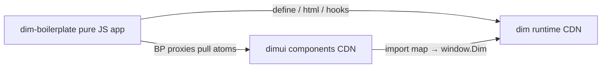
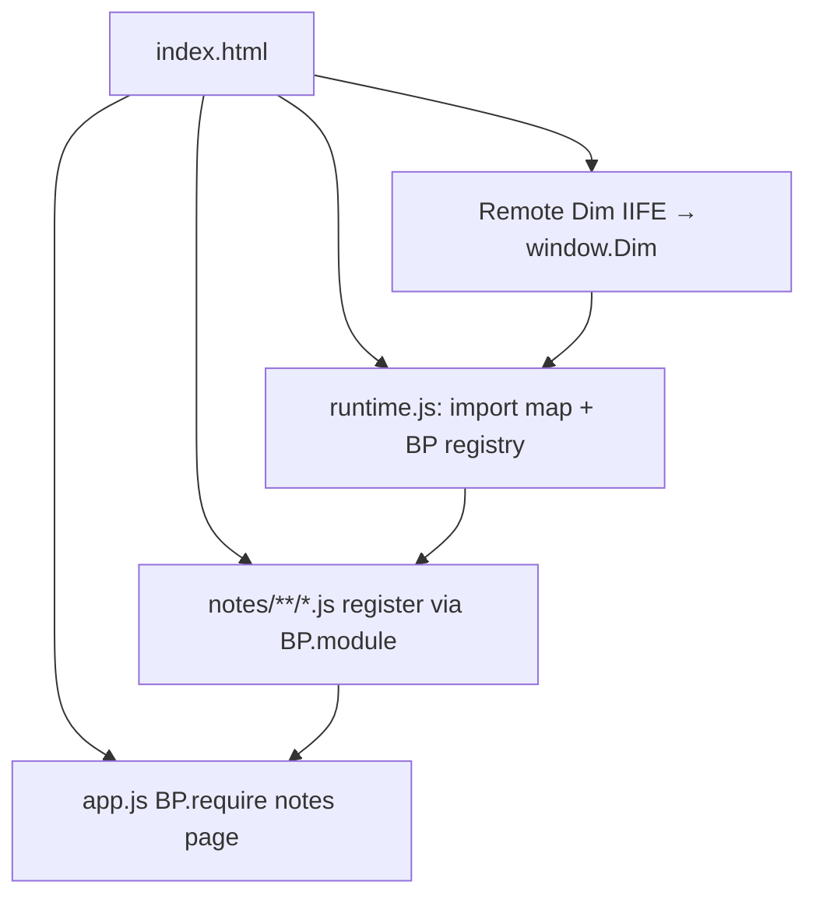

<p align="center">
  
</p>

<h1 align="center">dim-boilerplate</h1>

<p align="center">
  <strong>Encrypted notes demo for building with Dim — plain JavaScript</strong>
</p>

<p align="center">
  No app-side transpile, no npm install, no bundler. Open
  <a href="./index.html"><code>index.html</code></a> in Chrome or use the live site.
</p>

<div align="center">
  
[**Live Demo**](https://positive-intentions.github.io/dim-boilerplate/) | [**dim**](https://github.com/positive-intentions/dim) | [**dimui**](https://github.com/positive-intentions/dimui) | [**dimurl**](https://github.com/positive-intentions/dimurl)

</div>

<div align="center">
  
 
 
 


[](https://github.com/positive-intentions/dim-boilerplate/actions/workflows/pages/pages-build-deployment)

</div>

---

**Docs:** [dim-boilerplate on positive-intentions.com](https://positive-intentions.com/docs/projects/dim/dim-boilerplate) · [Dim Getting Started](https://positive-intentions.com/docs/projects/dim/getting-started) · [Unit / E2E / Coverage](https://positive-intentions.com/docs/projects/dim/unit-tests)

Your **application logic** is ordinary `.js` files in this repo. The Dim
runtime, reusable [dimui](https://github.com/positive-intentions/dimui)
widgets, and [dimurl](https://github.com/positive-intentions/dimurl) hash
router load from their GitHub Pages CDNs over the network. Opening a note
updates the URL (e.g. `#/note/note-welcome`) so deep links work on Pages.

## Dim in 30 seconds

Dim is a small framework: functional components + hooks, registered as **web
components**. Load the CDN IIFE first (`window.Dim`), then register components.
Hooks come from the second argument of your component function.

```js
const { define } = Dim;

define({
  tag: "demo-counter",
  component: (props, { html, useState }) => {
    const [count, setCount] = useState(0);
    return html`
      <button @click="${() => setCount(count + 1)}">
        Count: ${count}
      </button>
    `;
  },
});

// Then mount: <demo-counter></demo-counter>
```

That’s the core loop: CDN script → `define` → `html` template → `useState`
(and friends). For effects, styling, encrypted `useStore`, and more, see the
[Dim docs](https://positive-intentions.com/docs/projects/dim/getting-started).

## The four pieces

| Piece | Repo | Job here |
| ----- | ---- | -------- |
| **Framework** | [dim](https://github.com/positive-intentions/dim) | `define`, `html`, hooks — classic IIFE → `window.Dim` |
| **Shared UI** | [dimui](https://github.com/positive-intentions/dimui) | Atoms (Button, Icon, …) as classic scripts on Pages |
| **Hash router** | [dimurl](https://github.com/positive-intentions/dimurl) | `#/note/:id`, `#/folder/:id` for static hosting |
| **This app** | dim-boilerplate | Notes vault, folders, list/editor — **your** pure JS |



dimui is pulled **by URL at runtime** (one file per component). Local
`notes/components/atoms/*.js` files are thin **proxies** so opening
`button.js` shows it re-exports dimui’s Button — app code never npm-installs
dimui.

## How this app boots



1. `index.html` sync-loads Dim from
   `https://positive-intentions.github.io/dim/lib/` (JS or WASM via `?impl=`).
2. [`runtime.js`](./runtime.js) exposes `globalThis.BP` for local classic
   scripts and loads remote dimui modules as classic `<script src>` files
   (they call `BP.module` into this page). Dim APIs come from `window.Dim`.
3. Each file under `notes/` calls `BP.module(...)`.
4. [`app.js`](./app.js) does `BP.require("notes/components/pages/notes-app")`
   and renders the notes UI.

## Where to look in the tree

```
dim-boilerplate/
├── index.html              # loads Dim + all classic scripts + PWA meta
├── runTests.html           # DimTest runner + live coverage (no tests/ folder)
├── runtime.js              # BP registry + dimui/* classic script loader
├── app.js                  # host chrome (JS/WASM + theme toggles)
├── pwa.js                  # SW register + CDN harvest + install prompt API
├── sw.js                   # precache + stale-while-revalidate + CDN proxy
├── manifest.webmanifest    # installable app metadata (+ screenshots)
├── public/                 # README logo (dim.png)
├── icons/                  # 192 / 512 / maskable / SVG PWA icons
├── screenshots/            # narrow + wide images for richer install UI
└── notes/
    ├── e2e/         # iframe AUT specs (DimTest.open → index.html)
    ├── lib/         # vault, tokens, …; mockData/ + note-filters/ (src + *.test.js)
    └── components/
        ├── atoms/       # proxies → remote dimui
        ├── molecules/   # note-item/ (component + *.test.js), confirm-dialog, …
        ├── organisms/   # list, editor, shell, unlock
        ├── templates/   # notes-layout
        └── pages/       # notes-app/ (page + *.test.js)
```

Start at [`notes/components/pages/notes-app/notes-app.js`](./notes/components/pages/notes-app/notes-app.js)
(unlock vs vault), then
[`notes/components/organisms/notes-shell.js`](./notes/components/organisms/notes-shell.js)
(encrypted `useStore` + folders). Folder rows and editors are local pure JS;
buttons/icons come through atom proxies.

## Quick start

1. Clone this repo.
2. Open `index.html` in Chrome (network required for Dim + dimui + dimurl).
3. Create a vault password, add notes, lock / unlock.

Runtimes: `?impl=js` or `?impl=wasm` (also in the header). Choice is stored in
`localStorage`. Local kits: `?dimuiSrc=…` and `?dimurlSrc=…`. Note URLs look
like `#/note/note-welcome` after unlock.

## Application tests (uncompiled)

The notes app stays plain classic scripts — no transpile for tests either.
[`runTests.html`](./runTests.html) (next to `index.html`) loads the same Dim
IIFE + `BP` notes modules as the app (without `app.js` / `pwa.js`), then runs
[DimTest](https://github.com/positive-intentions/dim/tree/HEAD/examples/app-test)
from the Dim CDN.

```bash
# From the repo root (HTTP required for classic dimui script loads)
python3 -m http.server 4173
# Open:
#   http://127.0.0.1:4173/runTests.html
#   http://127.0.0.1:4173/runTests.html?impl=wasm
```

Specs sit **next to the source** in that module’s folder (e.g.
`notes/lib/note-filters/note-filters.test.js`,
`notes/components/molecules/note-item/note-item.test.js`). They call
`BP.require(...)` and `DimTest.mount(...)` against the real modules. The
harness paints a pass/fail report and sets `window.__DIM_TEST__` for CI.

**Iframe e2e (same runner, no transpile):** helpers in
[`notes/e2e/helpers.js`](./notes/e2e/helpers.js) plus specs
`notes-app` / `notes-crud` (edit note) / `notes-organize` / `notes-hash` /
`app-shell` use `DimTest.open("./index.html")` (fetch + `srcdoc` with
isolation: IndexedDB suffix, session `localStorage`, SW register no-op). Specs
under `notes/e2e/` run **after** unit tests. Report layout: **Results →
Coverage (unit lines) → E2E** (pass progress, e2e tree, **separate E2E line
coverage** from instrumented `notes/**` inside the iframe, live preview). CI
still requires **100% unit** coverage only; e2e coverage is logged
informationally. Until Pages ships the harness, use a local dim lib:

```bash
# Terminal A — dim Pages tree
python3 -m http.server 8765 --directory /path/to/dim/Frontend
# Terminal B — this app
python3 -m http.server 4173
# Open:
#   http://127.0.0.1:4173/runTests.html?dimLib=http://127.0.0.1:8765/lib/
```

**Runner chrome (owned by DimTest, not this page):** animated splash while
booting, toolbar with **JS | WASM** (reloads `?impl=` like the app), **Rerun**
(re-runs the suite without reloading Dim), and the results / coverage / E2E
preview panel.

**Harness (CDN, no copies in this repo):**

- `https://positive-intentions.github.io/dim/lib/dim.test.global.js`
- `https://positive-intentions.github.io/dim/lib/dim.cover.global.js`

While iterating on the harness locally, point at a dim Pages tree with
`?dimLib=http://127.0.0.1:8765/lib/` (serve `dim/Frontend`).

**Live coverage:** `runTests.html` fetches each `notes/**/*.js` file, instruments
executable lines in the browser with Dim’s first-party **DimParse** (embedded in
`dim.cover.global.js` — no Acorn / jsDelivr; test-only — production sources on
disk are never rewritten), and shows a **Coverage** block (unit bucket): overall %,
per-file hit/total, and expandable uncovered line ranges. Dim, `runtime.js`,
dimui, and `*.test.js` are excluded. The suite aims for **100%** of those
instrumented notes lines; CI fails `?impl=js` if any uncovered lines remain.
E2E opens rewrite the same `notes/**` script tags into a second **e2e** cover
bucket (shown under the E2E section); that % is not CI-gated.

**CI:** [`.github/workflows/test.yml`](./.github/workflows/test.yml) serves the
repo and opens both `?impl=js` and `?impl=wasm` with Playwright. Playwright is
installed only in the Action (`npx`) — there is still no app `package.json` or
bundler. Optional `DIM_LIB` env (see `.github/scripts/run-app-tests.mjs`) points
at a local dim `Frontend/lib/` while iterating on DimParse/cover. Live suite on
Pages (after deploy): `/dim-boilerplate/runTests.html`.

## PWA / offline

On **HTTPS** or **localhost** (not `file://`, and not typical LAN
`http://192.168.x.x`):

1. First visit loads Dim + dimui from their GitHub Pages CDNs and registers
   [`sw.js`](./sw.js). The worker precaches this app’s shell and harvests the
   CDN URLs that actually loaded.
2. Later visits (even without installing) are controlled by the service
   worker. Dim/dimui are requested via same-scope `./pwa/cdn/...` paths so the
   worker can intercept them, serve the cache immediately, and revalidate in
   the background (stale-while-revalidate).
3. Offline after that first visit: the notes UI boots from cache. Encrypted
   vault data still lives in IndexedDB as before.

### Install

[`manifest.webmanifest`](./manifest.webmanifest) makes the app installable
(standalone display, icons, screenshots). Chrome does **not** always show an
automatic banner: it waits for engagement heuristics (about **30 seconds** on
the page plus at least one tap) and may hide the mini-infobar if the user
dismissed it earlier.

This app surfaces install explicitly:

- **Android / desktop Chromium** — after the criteria are met,
  `beforeinstallprompt` enables an **Install** button in the header. Tapping
  it opens the system install dialog. The button is hidden in standalone /
  already-installed mode.
- **iOS Safari** — there is no install prompt API. A short tip points to
  **Share → Add to Home Screen** (meta tags + apple-touch-icon are already
  set).
- **Insecure context** — service workers and installability need HTTPS or
  localhost. Opening via `file://` or a plain HTTP LAN IP will not register
  the worker or fire `beforeinstallprompt`.

`file://` cannot use service workers — double-clicking `index.html` still
needs network for Dim + dimui. Use a local static server
(`npx serve .` / `python -m http.server`) on localhost, or the live Pages
URL, to exercise the PWA path.

## Deploy

Published from **`staging`** with no build step
([`.github/workflows/deploy-pages.yml`](./.github/workflows/deploy-pages.yml)):

https://positive-intentions.github.io/dim-boilerplate/

Same files as on disk — Pages is just another host (including `sw.js`,
`pwa.js`, `manifest.webmanifest`, and `icons/`).

## Adding a component

1. **Shared atom** — proxy under `notes/components/atoms/` depending on
   `dimui/components/atoms/<name>`, plus a `<script>` in `index.html`.
2. **App UI** — one `define()` per file under molecules / organisms / templates /
   pages; register with `BP.module("notes/components/...", deps, factory)`.
   Prefer a folder per module when you add tests (same for `notes/lib/`):
   `notes/components/molecules/foo/foo.js` + `foo.test.js` (BP id stays
   `notes/components/molecules/foo`). Add the new script to `index.html` and
   the instrument/test lists in `runTests.html`.
3. Depend on local module ids (e.g. `notes/components/atoms/button`), not a
   grab-bag `"dimui"` name.

In Dim `html\`...\`` templates, childless custom elements may use
`<dimui-icon .props="${{ name: "plus" }}" />`. Do **not** use `/>` in raw
`index.html` — the browser won’t treat custom elements as void.

## Caveats

- First HTTPS/localhost visit still needs network for Dim and dimui CDNs;
  later visits can run offline via the service worker (nothing vendored into
  this repo).
- CDN builds track dim / dimui Pages deploys (`staging` for dimui).
- Local `notes/` tracks
  [dimui’s notes demo](https://github.com/positive-intentions/dimui/tree/HEAD/src/demos/notes);
  re-sync manually when that demo changes.
- On `file://`, IndexedDB is shared across local HTML files in Chrome; service
  workers do not run on `file://`.
- Strict CSP: allow `'wasm-unsafe-eval'` for WASM Dim and `data:` for the Dim
  import-map shim.

## Related

- [dim](https://github.com/positive-intentions/dim) — framework
- [dimui](https://github.com/positive-intentions/dimui) — component explorer + atoms
- Live demo: https://positive-intentions.github.io/dim-boilerplate/
