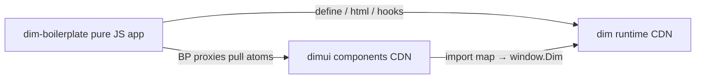
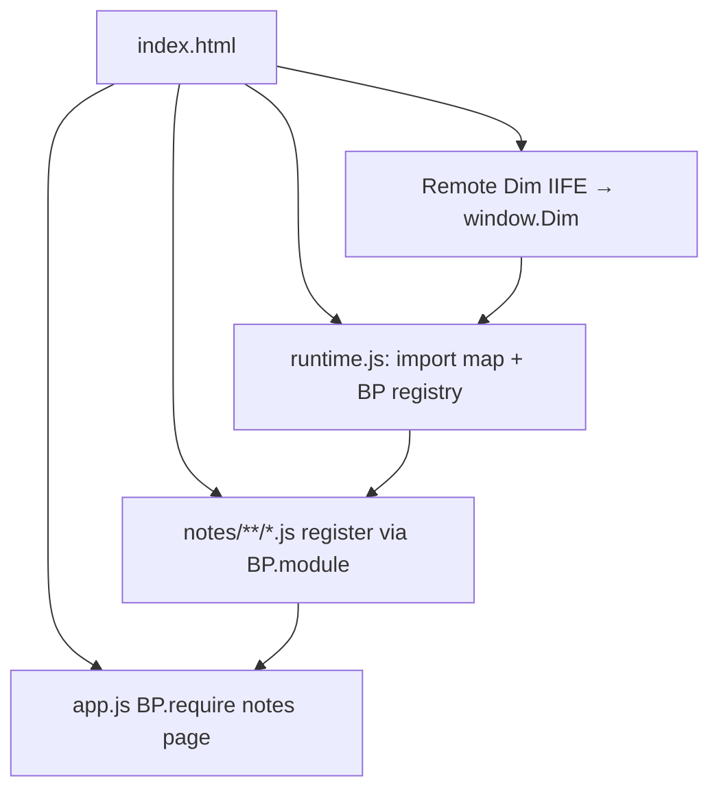

# dim-boilerplate

An **encrypted notes** demo for building with
[@positive-intentions/dim](https://github.com/positive-intentions/dim) using
**plain JavaScript** — no app-side transpile, no npm install, no bundler.

Open [`index.html`](./index.html) in Chrome (double-click / `file://`) or visit
the live site: https://positive-intentions.github.io/dim-boilerplate/

Your **application logic** is ordinary `.js` files in this repo. The Dim
runtime and reusable [dimui](https://github.com/positive-intentions/dimui)
widgets load from their GitHub Pages CDNs over the network.

## Dim in 30 seconds

Dim is a small framework: functional components + hooks, registered as **web
components**. Hooks come from the second argument of your component function
(not only from top-level imports).

```js
const { define } = Dim;

const Counter = define({
  tag: "demo-counter",
  component: (props, { html, useState }) => {
    const [count, setCount] = useState(0);
    return html`
      <button @click="${() => setCount(count + 1)}">
        Count: ${count}
      </button>
    `;
  },
});

// Then mount: <demo-counter></demo-counter>
```

That’s the core loop: `define` → `html` template → `useState` (and friends).
For effects, styling, encrypted `useStore`, and more, see the
[dim](https://github.com/positive-intentions/dim) README and docs.

## The three pieces

| Piece | Repo | Job here |
| ----- | ---- | -------- |
| **Framework** | [dim](https://github.com/positive-intentions/dim) | `define`, `html`, hooks — classic IIFE → `window.Dim` |
| **Shared UI** | [dimui](https://github.com/positive-intentions/dimui) | Atoms (Button, Icon, …) as unbundled ESM on Pages |
| **This app** | dim-boilerplate | Notes vault, folders, list/editor — **your** pure JS |



dimui is pulled **by URL at runtime** (one file per component). Local
`notes/components/atoms/*.js` files are thin **proxies** so opening
`button.js` shows it re-exports dimui’s Button — app code never npm-installs
dimui.

## How this app boots



1. `index.html` sync-loads Dim from
   `https://positive-intentions.github.io/dim/lib/` (JS or WASM via `?impl=`).
2. [`runtime.js`](./runtime.js) adds an import map so remote dimui ESM can use
   `@positive-intentions/dim` against `globalThis.Dim`, and exposes
   `globalThis.BP` for local classic scripts (`file://` cannot use local ESM).
3. Each file under `notes/` calls `BP.module(...)`.
4. [`app.js`](./app.js) does `BP.require("notes/components/pages/notes-app")`
   and renders the notes UI.

## Where to look in the tree

```
dim-boilerplate/
├── index.html       # loads Dim + all classic scripts
├── runtime.js       # import map + BP + dimui/* resolver
├── app.js           # host chrome (JS/WASM + theme toggles)
└── notes/
    ├── lib/         # vault helpers, tokens, seed data
    └── components/
        ├── atoms/       # proxies → remote dimui
        ├── molecules/   # note-item, confirm-dialog, …
        ├── organisms/   # list, editor, shell, unlock
        ├── templates/   # notes-layout
        └── pages/       # notes-app (password gate)
```

Start at [`notes/components/pages/notes-app.js`](./notes/components/pages/notes-app.js)
(unlock vs vault), then
[`notes/components/organisms/notes-shell.js`](./notes/components/organisms/notes-shell.js)
(encrypted `useStore` + folders). Folder rows and editors are local pure JS;
buttons/icons come through atom proxies.

## Quick start

1. Clone this repo.
2. Open `index.html` in Chrome (network required for Dim + dimui).
3. Create a vault password, add notes, lock / unlock.

Runtimes: `?impl=js` or `?impl=wasm` (also in the header). Choice is stored in
`localStorage`.

## Deploy

Published from **`staging`** with no build step
([`.github/workflows/deploy-pages.yml`](./.github/workflows/deploy-pages.yml)):

https://positive-intentions.github.io/dim-boilerplate/

Same files as on disk — Pages is just another host.

## Adding a component

1. **Shared atom** — proxy under `notes/components/atoms/` depending on
   `dimui/components/atoms/<name>`, plus a `<script>` in `index.html`.
2. **App UI** — one `define()` per file under molecules / organisms / templates /
   pages; register with `BP.module("notes/components/...", deps, factory)`.
3. Depend on local module ids (e.g. `notes/components/atoms/button`), not a
   grab-bag `"dimui"` name.

In Dim `html\`...\`` templates, childless custom elements may use
`<dimui-icon .props="${{ name: "plus" }}" />`. Do **not** use `/>` in raw
`index.html` — the browser won’t treat custom elements as void.

## Caveats

- Needs network for Dim and dimui CDNs (nothing vendored offline here).
- CDN builds track dim / dimui Pages deploys (`staging` for dimui).
- Local `notes/` tracks
  [dimui’s notes demo](https://github.com/positive-intentions/dimui/tree/staging/src/demos/notes);
  re-sync manually when that demo changes.
- On `file://`, IndexedDB is shared across local HTML files in Chrome.
- Strict CSP: allow `'wasm-unsafe-eval'` for WASM Dim and `data:` for the Dim
  import-map shim.

## Related

- [dim](https://github.com/positive-intentions/dim) — framework
- [dimui](https://github.com/positive-intentions/dimui) — component explorer + atoms
- Live demo: https://positive-intentions.github.io/dim-boilerplate/
